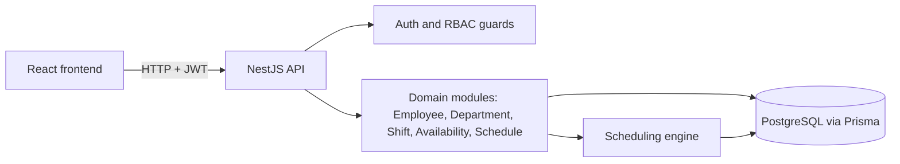
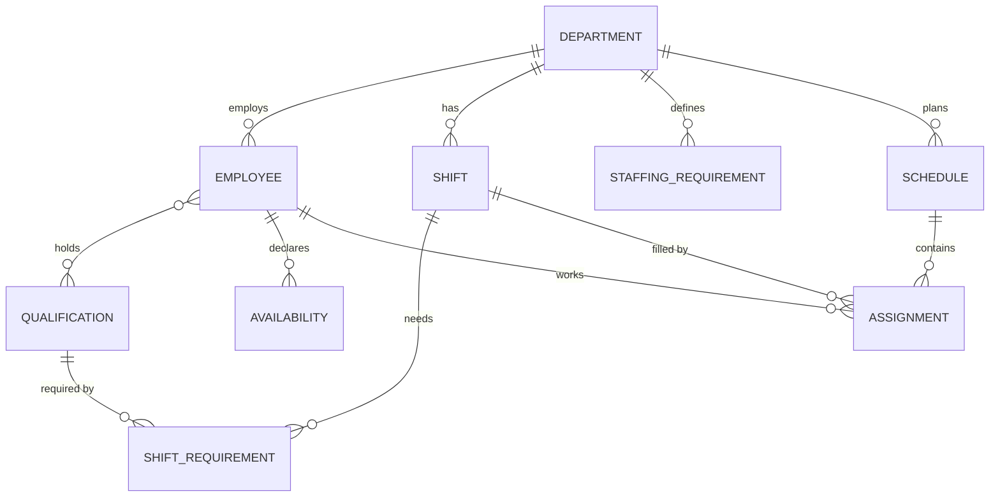
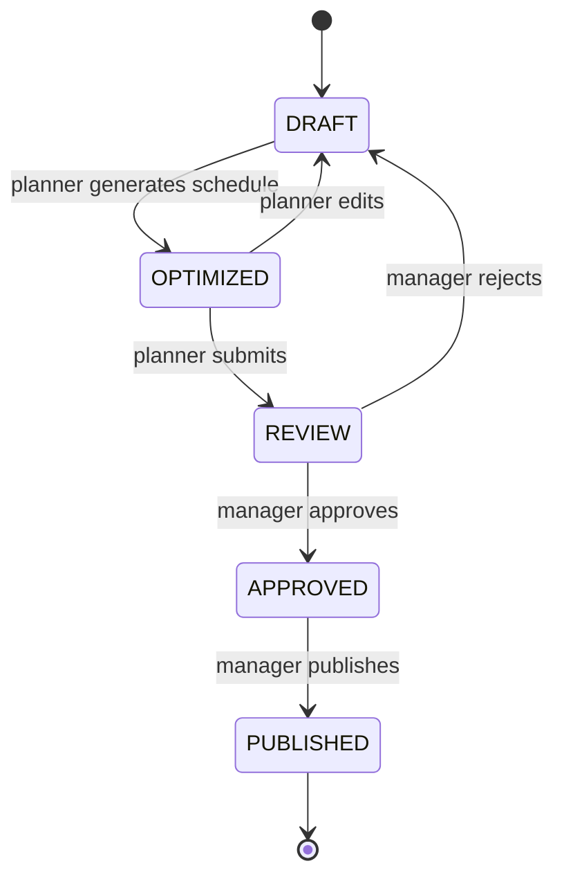

# Architecture - Healthcare Workforce Planning

## Purpose and scope

The system plans staff shifts for hospital departments. A planner defines shifts and their staffing needs, employees declare when they are available, and a scheduling engine assigns qualified, available employees to shifts without breaking working-time rules. A manager reviews and approves the schedule before it is published to employees. The main quality risk is not a crash but a wrong schedule: an unqualified nurse on a night shift, a rest period broken, a ward left understaffed, or a schedule published without approval. The tests are designed around those risks.

## System overview



| Component | Responsibility | Technology |
|---|---|---|
| Frontend | Login, employee, shift, availability and schedule pages, approval actions | React |
| API | REST endpoints, validation, authentication, role checks | NestJS |
| Scheduling engine | Checks hard constraints, assigns employees, scores soft constraints | TypeScript service inside NestJS, no database access of its own |
| Database | Persistent storage | PostgreSQL, schema managed by Prisma |

The scheduling engine is a pure function of its input (shifts, employees, availability, rules) and returns assignments plus violations and a score. Keeping it free of HTTP and database code means its rules can be unit tested with Jest in milliseconds, while Playwright tests cover the same rules end to end through the API.

## Domain model



| Entity | Key fields | Notes |
|---|---|---|
| Department | id, code, name | A ward or unit, for example Emergency or Internal Medicine |
| StaffingRequirement | departmentId, shiftType, minHeadcount | Default minimum staff per shift type in a department |
| Employee | id, name, email, role, departmentId, contractHoursPerWeek, active | Role is one of ADMIN, PLANNER, MANAGER, EMPLOYEE |
| Qualification | id, code, name | For example registered nurse, practical nurse, medication permit, ICU certification |
| EmployeeQualification | employeeId, qualificationId, validUntil | A qualification that has expired does not count |
| Availability | employeeId, start, end, type | Type is AVAILABLE, UNAVAILABLE or LEAVE. Partial days are separate time ranges |
| Shift | id, departmentId, start, end, type, requiredHeadcount | Type is MORNING, EVENING or NIGHT. A night shift crosses midnight |
| ShiftRequirement | shiftId, qualificationId, count | For example at least one person with a medication permit |
| Schedule | id, departmentId, periodStart, periodEnd, status, qualityScore | Status follows the approval workflow below |
| Assignment | scheduleId, shiftId, employeeId | One employee at most once per shift |

All timestamps are stored in UTC and shown in Europe/Helsinki time. This matters because a night shift can cross a daylight saving change, which makes it 7 or 9 hours long instead of 8.

## Approval workflow



Only DRAFT and OPTIMIZED schedules can be edited. A schedule that is not APPROVED cannot be published, and an APPROVED or PUBLISHED schedule cannot be changed without going back through the workflow.

## Roles and permissions

| Action | Admin | Planner | Manager | Employee |
|---|---|---|---|---|
| Manage employees, departments, qualifications | Yes | No | No | No |
| Manage shifts and staffing requirements | Yes | Yes | No | No |
| Declare own availability | Yes | Yes | Yes | Yes |
| View all availability in own department | Yes | Yes | Yes | No |
| Generate, edit and submit a schedule | Yes | Yes | No | No |
| Approve, reject and publish a schedule | Yes | No | Yes | No |
| View published schedule | Yes | Yes | Yes | Own shifts only |

Authentication uses JWT. NestJS guards check the role on every endpoint, and services check ownership (an employee may only change their own availability).

## Repository layout

```
apps/backend/    NestJS API (modules, Prisma schema, scheduling engine, Jest unit tests)
apps/frontend/   React UI
playwright/      API and end-to-end tests (pages, fixtures, api clients, factories, utils)
docs/            architecture, business rules, risk analysis, test strategy, AI-assisted testing
```

## Decisions and open questions

- The scheduling engine uses a priority-based, multi-pass assignment, not an academic constraint solver. This is a deliberate engineering decision: the rules stay readable and testable, at the cost of not always finding the best possible schedule.
- Publishing is done by the manager who approved the schedule. This could also be a separate step for the planner. Decision to confirm before the workflow module (day 20/11).
- Rule values (rest period, maximum hours) are configurable and documented in `business-rules.md` as design assumptions, not as legal advice.
