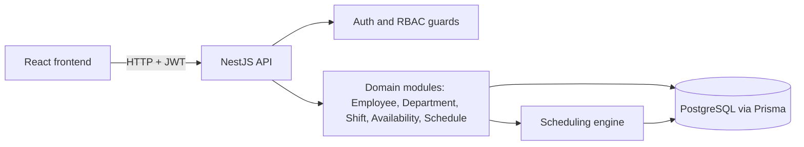
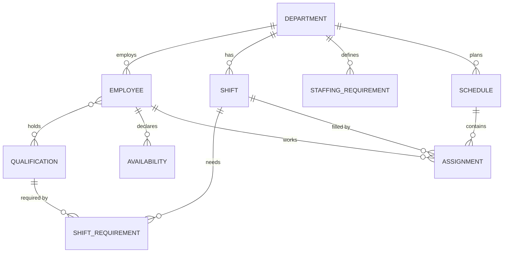
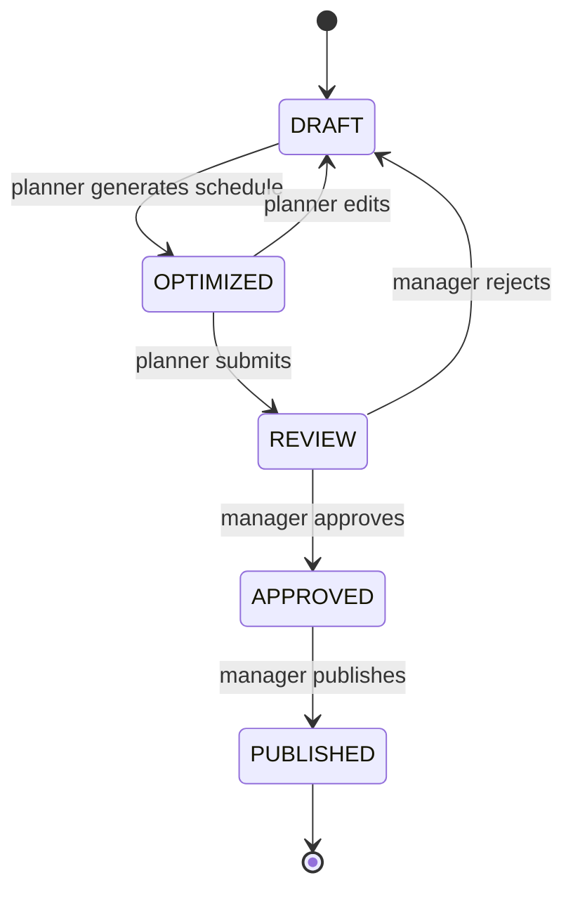

# Architecture - Healthcare Workforce Planning

## Purpose and scope

The system plans staff shifts for hospital departments. A planner defines shifts and their staffing needs, employees declare when they are available, and a scheduling engine assigns qualified, available employees to shifts without breaking working-time rules. A manager reviews and approves the schedule before it is published to employees. The main quality risk is not a crash but a wrong schedule: an unqualified nurse on a night shift, a rest period broken, a ward left understaffed, or a schedule published without approval. The tests are designed around those risks.

## System overview



| Component | Responsibility | Technology |
|---|---|---|
| Frontend | Login, employee, shift, availability and schedule pages, approval actions | React |
| API | REST endpoints, validation, authentication, role checks | NestJS |
| Scheduling engine | Checks hard constraints, assigns employees, scores soft constraints | TypeScript service inside NestJS, no database access of its own |
| Database | Persistent storage | PostgreSQL, schema managed by Prisma |

The scheduling engine is a pure function of its input (shifts, employees, availability, rules) and returns assignments plus violations and a score. Keeping it free of HTTP and database code means its rules can be unit tested with Vitest in milliseconds, while Playwright tests cover the same rules end to end through the API.

## Domain model



| Entity | Key fields | Notes |
|---|---|---|
| Department | id, code, name | A ward or unit, for example Emergency or Internal Medicine |
| StaffingRequirement | departmentId, shiftType, minHeadcount | Default minimum staff per shift type in a department |
| Employee | id, name, email, role, departmentId, contractHoursPerWeek, active | Role is one of ADMIN, PLANNER, MANAGER, EMPLOYEE |
| Qualification | id, code, name | For example registered nurse, practical nurse, medication permit, ICU certification |
| EmployeeQualification | employeeId, qualificationId, validUntil | A qualification that has expired does not count |
| Availability | employeeId, start, end, type | Type is AVAILABLE, UNAVAILABLE or LEAVE. Partial days are separate time ranges |
| Shift | id, departmentId, start, end, type, requiredHeadcount | Type is MORNING, EVENING or NIGHT. A night shift crosses midnight |
| ShiftRequirement | shiftId, qualificationId, count | For example at least one person with a medication permit |
| Schedule | id, departmentId, periodStart, periodEnd, status, qualityScore | Status follows the approval workflow below |
| Assignment | scheduleId, shiftId, employeeId | One employee at most once per shift |

All timestamps are stored in UTC and shown in Europe/Helsinki time. This matters because a night shift can cross a daylight saving change, which makes it 7 or 9 hours long instead of 8.

## Approval workflow



Only DRAFT and OPTIMIZED schedules can be edited. A schedule that is not APPROVED cannot be published, and an APPROVED or PUBLISHED schedule cannot be changed without going back through the workflow.

The workflow is implemented in `apps/backend/src/schedules` (day 20/11). `schedule-workflow.ts` holds the diagram as one table of actions, start statuses, end status and roles. The controller takes its `@Roles` from that table and the service its allowed statuses, so the diagram, the permission check and the status check cannot drift apart.

| Endpoint | Action | Roles |
|---|---|---|
| `POST /schedules` | Create a DRAFT for one department and period | Admin, Planner |
| `GET /schedules`, `GET /schedules/:id` | Read, with the actions the caller may take next | Every role, employees limited by BR-W04 |
| `GET /schedules/:id/check` | Hard violations and quality scores of the schedule as it is now | Admin, Planner, Manager |
| `POST /schedules/:id/generate` | Run the engine around the assignments made by hand | Admin, Planner |
| `POST /schedules/:id/assignments`, `DELETE /schedules/:id/assignments/:assignmentId`, `DELETE /schedules/:id` | Edit by hand, or delete an editable schedule | Admin, Planner |
| `POST /schedules/:id/submit` | Send an OPTIMIZED schedule to review | Admin, Planner |
| `POST /schedules/:id/approve`, `reject`, `publish` | Decide on a schedule in review, publish an approved one | Admin, Manager |

## Roles and permissions

| Action | Admin | Planner | Manager | Employee |
|---|---|---|---|---|
| Manage employees, departments, qualifications | Yes | No | No | No |
| Manage shifts and staffing requirements | Yes | Yes | No | No |
| Declare own availability | Yes | Yes | Yes | Yes |
| View all availability in own department | Yes | Yes | Yes | No |
| Generate, edit and submit a schedule | Yes | Yes | No | No |
| Approve, reject and publish a schedule | Yes | No | Yes | No |
| View published schedule | Yes | Yes | Yes | Own shifts only |

Authentication uses JWT. NestJS guards check the role on every endpoint, and services check ownership (an employee may only change their own availability).

## Repository layout

```
apps/backend/    NestJS API (modules, Prisma schema, scheduling engine, Vitest unit tests)
apps/frontend/   React UI
playwright/      API and end-to-end tests (pages, fixtures, api clients, factories, utils)
docs/            architecture, business rules, risk analysis, test strategy, AI-assisted testing
```

## Decisions and open questions

- The scheduling engine uses a priority-based, multi-pass assignment, not an academic constraint solver. This is a deliberate engineering decision: the rules stay readable and testable, at the cost of not always finding the best possible schedule. The design, with the exact rule definitions and the test plan, is in `scheduling-engine.md`.
- Publishing is done by an admin or a manager, the same roles that approve (decided day 20/11, following the permission table). A planner cannot publish, so a schedule reaches employees only through someone who did not build it, unless an admin does both.
- Rule values (rest period, maximum hours) are configurable and documented in `business-rules.md` as design assumptions, not as legal advice.
- The backend uses NestJS 12, which generates an ES module project (`"type": "module"`, imports end in `.js`) with Vitest instead of Jest and oxlint instead of ESLint. Vitest has the same `describe`, `it`, `expect` API as Jest, with `vi.fn()` in place of `jest.fn()`. The tracker says Jest; Vitest is kept because it is the framework default.
- Node 24 LTS is the required runtime (`.nvmrc`). Node 23 does not run the Nest CLI.
- Endpoints that the permission table does not cover, mainly reads, follow least privilege: departments, qualifications and availability can be read by every role, while employees, shifts and staffing requirements can be read by Admin, Planner and Manager. The full route list is the expected table in `apps/backend/src/auth/role-matrix.spec.ts`.
- Access is denied by default: a route without `@Roles` or `@Public` returns 403, so a forgotten decorator cannot open an endpoint.
- Passwords are hashed with scrypt from the Node crypto module, with a random salt per password and a length of 12 to 128 characters. Login gives the same message for every failure. Tokens use HS256, are valid for 8 hours and carry only the employee id and role. The API does not start without a JWT_SECRET of at least 32 characters.
- The first admin is created with `npm run create-admin`, which reads ADMIN_EMAIL and ADMIN_PASSWORD. Other passwords are set by an admin through `PUT /auth/password/:employeeId`.
- Ownership of availability (BR-A03) is checked by `AvailabilityAccess`. An admin may write anyone's availability, every other role only its own. An employee reads only its own records, a planner or manager reads its own department (only its own records when it has no department), and an admin reads everything.
- Trade-off: for a non admin, someone else's record answers 403 while a missing record answers 404, so the existence of a record can be inferred. A planner who asks for an employee outside its department gets an empty list rather than 403.
- Ids in paths and queries go through `ParseIdPipe` (1 to 2147483647), and integers in bodies through `parsePositiveInt`, so a number that does not fit in a PostgreSQL integer gives 400 instead of 500.
- Timestamps are checked part by part: a day that does not exist, such as 30 February, and the hour 24 are rejected instead of being moved by JavaScript.
- Every authenticated request loads the account through `ActiveUserGuard`: a deactivated account gets 401, and the role stored in the database replaces the role in the token. This costs one small query per request.
- The scheduling engine must keep 100 % test coverage (`npm run test:engine` fails below it), and an architecture test keeps NestJS, Prisma, the clock and randomness out of it.
- Every status change is one conditional update (`WHERE id = ? AND status IN (...)`), so two parallel requests cannot both move the same schedule. Generation saves only when `updatedAt` is unchanged since it read the schedule, so a parallel hand edit is not overwritten.
- Creating and approving a schedule run in serializable transactions. Periods of one department may not overlap, and approval checks the whole schedule again with the data of that moment (BR-W03), counting the shifts of other APPROVED and PUBLISHED schedules as busy time. Without the serializable level, parallel requests created overlapping schedules and approved two schedules that booked the same nurse at the same time (`risk-analysis.md`).
- With the pg driver adapter of Prisma 7, a serialization failure arrives as a `DriverAdapterError` with `originalCode` 40001, not as the documented P2034. `isWriteConflict` in `src/common/db-errors.ts` recognises both and the API answers 409.
- The engine's candidates are the employees of the schedule's department plus anyone assigned by hand from another department, for example a float nurse. A planning period is 1 to 42 days, which bounds the engine run inside one request.
- A hand edit moves the schedule back to DRAFT and clears its quality score, so every schedule passes through the engine and its validation again before review.
- Employees see only PUBLISHED schedules of their own department or with one of their shifts, and only their own assignments (BR-W04, BR-A03). Anything else answers 404, so an employee cannot learn that a draft exists.
- Not done yet for the workflow: approval by someone other than the submitter (an admin can do both, which needs a submitter column), limiting planners and managers to the schedules of their own department, a way to revise a published schedule (its shifts are locked since 07/11/2026, R-WF-02, so a change needs a new schedule version), and a night shift that starts on the last day of a period, which falls in neither period under BR-T03.
- The frontend (day 21/11) uses React 19, Vite 8, TypeScript and React Router, with Vitest and Testing Library for component tests. In development and preview, Vite forwards `/api/...` to the API, so the browser makes no cross-origin requests and the API needs no CORS settings. A production deployment needs the same forwarding in front of both.
- The UI keeps the access token in sessionStorage: a reload keeps the session and closing the tab ends it. A script injected into the page could read it, so the UI never renders HTML from data. An httpOnly cookie would avoid that risk but needs CSRF protection on the API, which is more than the login lesson covers.
- `GET /auth/me` returns the token's `sub` and `role` plus first name, last name, email and department, which the UI shows after login. The fields that existed before are unchanged.
- The UI only reflects permissions. Every rule stays enforced by the API, and any 401 on a request with a token ends the session in the UI, which covers an expired token and an account an admin deactivated (R-CONS-01, F-04).
- Not done yet: rate limiting of failed logins, logging out a single token before it expires, a database constraint against parallel overlapping availability (F-05), and upper limits for shift length and headcount, which need product decisions.
