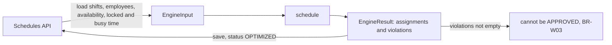

# Scheduling Engine - Design

This document defines what the scheduling engine must do before any of it is written: the exact meaning of every hard constraint, including its boundaries, the shape of the algorithm, and how each rule will be tested. The rules themselves are listed in `business-rules.md`. This document makes them precise enough to test.

Status: design written on 2026-11-01. The hard constraint checks are implemented in `apps/backend/src/scheduling/hard-constraints.ts`, with the local time helpers in `local-time.ts`, the assignment algorithm in `engine.ts`, and the soft scores and the schedule quality score in `soft-scores.ts`.

## Boundaries

The engine is a pure function: `schedule(input: EngineInput): EngineResult`. The types are in `apps/backend/src/scheduling/engine.types.ts`.

- No database, no HTTP and no clock inside the engine. The API loads the data, calls the engine and saves the result. This keeps every rule testable with plain objects in milliseconds. The architecture test `engine.architecture.spec.ts` fails when an engine file imports anything outside its folder, or reads the clock, randomness or the environment.
- The same input always gives the same output. Every tie is broken by id, so a test can expect an exact schedule.
- One call plans one department for one planning period. The candidates are the employees of that department.
- Times are instants (`Date`, stored in UTC). Calendar days and weeks are taken in the configured time zone, Europe/Helsinki by default (BR-T01).
- Rule values come from `RuleConfig` (rest 660 minutes, week 2400 minutes by default), never from constants inside the checks.

## Time conventions

- Every interval is half open, `[startsAt, endsAt)`. Two intervals overlap when `a.startsAt < b.endsAt` and `b.startsAt < a.endsAt`. An interval that ends at 16:00 does not overlap one that starts at 16:00.
- Durations are real elapsed minutes: `(endsAt - startsAt) / 60000`. Clock times are never subtracted.
- A local date `D` covers the instants from local midnight of `D` to local midnight of `D + 1`.
- A week runs from local Monday 00:00 to the next local Monday 00:00. Because of daylight saving time a week is not always 168 hours.

These facts were checked with Node's time zone data and are used as test fixtures:

| Case | Local times | Real length |
|---|---|---|
| Night shift over the end of daylight saving time | 24/10/2026 22:00 (+03:00) to 25/10/2026 06:00 (+02:00) | 9 h |
| Night shift over the start of daylight saving time | 27/03/2027 22:00 (+02:00) to 28/03/2027 06:00 (+03:00) | 7 h |
| Week that contains 25/10/2026 | Monday 19/10 00:00 to Monday 26/10 00:00 | 169 h |
| Week that contains 28/03/2027 | Monday 22/03 00:00 to Monday 29/03 00:00 | 167 h |

## Hard constraints

Each rule is a check that returns violations. The column "Allowed at the boundary" is what the boundary tests will assert.

| Rule | Exact definition | Allowed at the boundary | Violation when |
|---|---|---|---|
| BR-H01 qualification | For every requirement of the shift that the employee is counted for, the employee holds the qualification and it is valid for the whole shift: `validUntil` is null, or the shift ends no later than local midnight after `validUntil` | Qualification valid until 30/11, shift ends 01/12 at 00:00 | The same shift ends 01/12 at 00:01, or the employee does not hold the qualification |
| BR-H02 availability | No interval of type UNAVAILABLE or LEAVE of the employee overlaps the shift. AVAILABLE is only a preference (BR-S01). No record means available | Leave ends at 06:00, shift starts at 06:00 | Leave ends at 06:01 |
| BR-H03 overlap | No two shifts of the employee overlap, counting locked assignments and busy time | Shift ends 14:00, next starts 14:00 (then BR-H05 applies) | The next starts at 13:59 |
| BR-H04 weekly hours | For every week, the minutes of the employee's shifts that fall inside the week, counting busy time, are at most `maxWeeklyMinutes`. A shift that crosses Monday 00:00 is split between the two weeks | Exactly 2400 minutes | 2401 minutes |
| BR-H05 rest | Between the end of one shift and the start of the next shift of the same employee there are at least `minRestMinutes`, counting busy time | Exactly 660 minutes (11 h) | 659 minutes (10 h 59 min) |
| BR-H06 headcount | The shift has at least `requiredHeadcount` assigned employees, and for each requirement at least `count` of them hold that qualification validly for the shift. One employee may count for several requirements | Exactly the required numbers | One person or one qualification short |
| BR-H07 active | Only employees with `active` true are assigned | | An inactive employee is assigned |
| BR-T03 period | The shift lies inside the period: it starts at or after local midnight of `period.start` and ends at or before local midnight after `period.end` | A night shift on the last day that ends at 00:00 after it | The same night shift ending at 06:00 the next day |

Two consequences that the tests must cover:

- Back to back shifts (14:00 end, 14:00 start) are not an overlap, but they break the rest rule. The violation must name BR-H05, not BR-H03.
- A night shift across the end of daylight saving time counts 9 hours toward BR-H04, and its rest period is measured in real time, so the clock suggests one hour less rest than the employee really had.

## Two levels of checking

| Level | Used by | Rules | Question it answers |
|---|---|---|---|
| Candidate check | The algorithm, before every assignment (day 15/11) | BR-H01, BR-H02, BR-H03, BR-H04, BR-H05, BR-H07, BR-T03 | Can this employee take this shift, given everything assigned so far? |
| Schedule validation | The end of every engine run, and the API before APPROVED (BR-W03) | All of them, including BR-H06 | Which hard rules does this whole schedule break? |

An assignment does not record which requirement the employee fills, so the schedule validation reports a missing or expired qualification as a BR-H06 shortage of that qualification. BR-H01 is reported by the candidate check, which knows the requirement it is filling.

The schedule validation must not trust the algorithm. It is written as a separate function and also runs on schedules a planner edited by hand. One invariant ties the two together: every assignment the algorithm adds passes the candidate check against the final schedule. A test runs the validation on the engine's own output and expects no employee level violation.

## Algorithm outline

The algorithm is priority based and runs in several passes. It is a greedy heuristic, not a constraint solver. This is a deliberate engineering decision: every assignment can be explained by a rule, the code stays small enough to test fully, and the result is the same on every run. The cost is that it can miss a valid schedule that a solver would find. When that happens the result says so through BR-H06 violations, and the planner fixes the gap by hand.

1. Validate the input. Shifts outside the period get a BR-T03 violation and are not staffed. Locked assignments are kept and checked like any other.
2. Order the shifts, hardest first: shifts with qualification requirements before those without, then by the fewest employees who pass the candidate check for the scarcest qualification, then night shifts, then start time, then id.
3. Pass 1, requirements: fill one qualified place at a time, always for the open requirement with the least slack (qualified candidates who pass the candidate check, minus the people still missing). The order of step 2 breaks a tie.
4. Pass 2, headcount: fill one remaining place at a time, always on the open shift with the least slack (candidates minus open places), again with the order of step 2 to break a tie.
5. Pass 3, report: run the schedule validation and return its violations.

Candidates are ranked by the most open requirements of the shift they cover, then the highest schedule quality score after the assignment (see Soft scores), then a matching AVAILABLE record, and finally the lowest employee id. The AVAILABLE key is needed because the preference score leaves out employees who never stated a preference, so the score cannot tell a match from a neutral choice.

A small example of what the greedy approach can miss: two shifts at the same time, one needs a qualification that only Aino holds, the other needs anyone. If the second shift were staffed first, it could take Aino and leave the first one unfilled. Ordering the hardest shift first avoids this case, but not every case of this kind.

The first version filled the shifts in the fixed order of step 2. An exhaustive search on small random inputs showed what that cost, so both passes now pick the place with the least slack. The numbers below come from 3746 small inputs with many requirements, of which 499 have a complete valid schedule:

| Version | Complete schedules missed |
|---|---|
| Fixed order in both passes | 45 of 499 (9.0 %) |
| Least slack in pass 2 only | 18 of 499 (3.6 %) |
| Least slack in both passes (current) | 10 of 499 (2.0 %) |

Every miss shows as a BR-H06 violation, never as a broken rule. `engine.spec.ts` keeps one of the remaining misses as a documented example, and the two cases the fixed order missed as regression tests.

Choosing by least slack calls the candidate check far more often, and each call converted times between time zones. The checks therefore index the input and cache the time zone results once per input. In the scratch environment one department with 100 shifts and 50 employees went from 17 s to 0.66 s (50 x 25: 0.17 s, 150 x 60: 1.6 s), and the output was identical before and after the change on 1000 random inputs. The input must not change during a run.

## Soft scores

Each soft goal gets a score from 0 to 100, where 100 is the best. The scores are measured, never enforced: a low score does not block approval, a hard violation does.

| Score | Definition | Why this way |
|---|---|---|
| BR-S01 preference | Share of assignments fully inside an AVAILABLE record, counting only employees who marked some AVAILABLE time | Someone who never stated a preference cannot be pleased or disappointed by an assignment |
| BR-S02 fairness | 100 x (1 - Gini) of night and weekend shifts per contract minute | The Gini coefficient is 0 for a perfectly even spread and does not depend on the unit, and dividing by contract minutes keeps part time staff from looking short changed |
| BR-S03 workload | 100 x (1 - Gini) of assigned real minutes per contract minute | Real minutes, so a 9 hour night over a daylight saving change weighs as 9 hours |
| BR-S04 overtime | Share of assigned minutes that are not overtime, counted per local week above the contract | Contracts are weekly, and busy time outside the schedule fills the week first, so the schedule is not blamed for overtime it did not add |

Only active employees with contract hours take part in BR-S02 and BR-S03. An empty schedule scores 100 on all three, because nobody is favoured.

Baseline of the current ranking, as the average over 300 seeded random inputs, against a version that chooses by employee id only:

| Inputs | Ranking | Preference | Fairness | Workload |
|---|---|---|---|---|
| 4 to 12 shifts, 3 to 6 employees | current | 33.3 | 76.8 | 91.6 |
| 4 to 12 shifts, 3 to 6 employees | id only | 35.3 | 62.0 | 69.5 |
| 40 shifts, 12 employees | current | 10.9 | 83.2 | 96.7 |
| 40 shifts, 12 employees | id only | 7.9 | 61.7 | 70.6 |

The ranking already improves fairness and workload a lot. Preference stays low, and on small inputs even below the id only version, because AVAILABLE only breaks ties after the load.

### Quality score

The quality score is the weighted average of the four scores, with the weights recorded in `business-rules.md` (overtime 0.30, preference 0.25, fairness 0.25, workload 0.20). Since day 18/11 the engine ranks candidates by the quality score the schedule would have after the assignment. Before and after, on the same seeded inputs:

| Inputs | Ranking | Preference | Fairness | Workload | Overtime | Quality | Time per run |
|---|---|---|---|---|---|---|---|
| 300 small inputs | previous | 33.3 | 76.8 | 91.6 | 100.0 | 75.8 | 1.6 ms |
| 300 small inputs | quality | 48.9 | 77.5 | 87.1 | 100.0 | 79.0 | 2.1 ms |
| 300 inputs, 40 shifts, 12 employees | previous | 10.9 | 83.2 | 96.7 | 99.8 | 72.8 | 36 ms |
| 300 inputs, 40 shifts, 12 employees | quality | 23.7 | 89.3 | 93.2 | 99.8 | 76.8 | 44 ms |
| 5 inputs, 100 shifts, 50 employees | previous | 21.2 | 78.0 | 93.6 | 100.0 | 73.5 | 0.69 s |
| 5 inputs, 100 shifts, 50 employees | quality | 99.2 | 72.1 | 79.7 | 100.0 | 88.8 | 0.87 s |

The quality score rose on every size, mostly through preference. Workload fell, and fairness fell on the largest inputs: that is the trade off the weights set, and a reason to confirm them with the product owner. Coverage did not suffer: on the 3746 inputs of the exhaustive search, the engine missed 10 complete schedules before and after the change. The random inputs give each employee only a few shifts, so the overtime score stays near 100 there, and its behaviour is covered by tests written by hand.

One defect came up while switching: the floating point sums inside the Gini coefficient depended on the order of the employees, so two equal candidates differed by about 1e-16 and the input order decided between them. The property test on input order caught it, and the Gini coefficient now sorts its values before adding them.

## Test plan

The unit tests live next to the engine and use fixed dates, never the current time.

| What | Cases | Level |
|---|---|---|
| Each hard rule | The allowed boundary and the first value past it, from the table above | Vitest, one file per rule |
| Daylight saving time | Both night shifts and both short and long weeks from the fixture table, for BR-H04 and BR-H05 | Vitest |
| Busy time | A shift on the first Monday after a Sunday night in the previous period, for rest and weekly hours | Vitest |
| Invariant | The schedule validation reports no employee level violation on any engine output | Vitest, run on every fixture |
| Determinism | Two runs on the same input give the same assignments | Vitest |
| Greedy limits | A fixture where the result has a BR-H06 violation, documented as expected | Vitest |
| End to end | Generate a schedule through the API and check the rules on what was saved | Playwright, group D |

Implemented so far: 48 tests for the hard constraints and the local time helpers, one file per rule, 14 example tests for the algorithm (including the regression cases and the known greedy limit) and 4 properties checked on 300 seeded random inputs. The soft scores have 17 tests with values worked out by hand and 3 properties on random inputs. All 9 deliberate mistakes in the scores, such as taking the weekend from the UTC date, were caught. Overtime and the quality score have 12 more tests, and all 10 deliberate mistakes in them and in the new ranking were caught.

Coverage (day 19/11): `npm run test:engine` runs the engine tests with coverage and fails below 100 % of statements, branches, functions and lines, which was checked by removing a test file. Before the gaps were closed, branch coverage was 94.6 %. Two error paths had no test (a local date in the wrong format, and assignments to shifts or employees the input does not know), one edge case was untested (a busy interval of zero minutes), and four branches were defaults that could never be used, which were removed instead of tested. Full coverage only shows that every line ran. The deliberate mistakes above are what show that the tests also check the results.

The architecture test reads the engine's source files. Inserting an import of NestJS, a type import of the Prisma client, a call to `Date.now()` or a call to `Math.random()` each made it fail, while a comment that mentions `Date.now()` did not. Each boundary was then broken on purpose in the code, for example `<` changed to `<=` in the rest check: all 11 deliberate mistakes made at least one test fail. The same was done with 10 mistakes in the algorithm: 8 were caught at once, one revealed a test that passed for the wrong reason (it was rewritten and now catches it), and one changed nothing because the candidate check already enforces the period.

## Open questions

- Is the qualification rule meant for the whole shift, as defined here, or only for the date the shift starts? The stricter reading is used until the product owner decides.
- Resolved: `isQualificationValid` in the employees module compared dates in UTC, which kept an expired qualification valid for up to 3 hours after local midnight. It now uses the Helsinki local date, like the engine.
- Can employees be planned across departments? The design assumes not.
- Is overstaffing allowed, for example for training? The algorithm never assigns more than `requiredHeadcount`, and the validation does not report it.
- Upper limits for shift length and headcount (finding F-07 in `exploratory-testing.md`) are still open.
