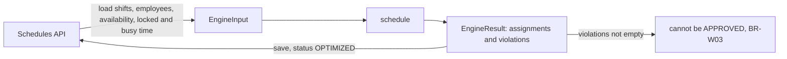

# Scheduling Engine - Design

This document defines what the scheduling engine must do before any of it is written: the exact meaning of every hard constraint, including its boundaries, the shape of the algorithm, and how each rule will be tested. The rules themselves are listed in `business-rules.md`. This document makes them precise enough to test.

Status: design, written on 2026-11-01. Implementation follows in three steps: hard constraint checks (day 15/11), the assignment algorithm (day 16/11) and soft constraint scoring (days 17/11 and 18/11).

## Boundaries

The engine is a pure function: `schedule(input: EngineInput): EngineResult`. The types are in `apps/backend/src/scheduling/engine.types.ts`.

- No database, no HTTP and no clock inside the engine. The API loads the data, calls the engine and saves the result. This keeps every rule testable with plain objects in milliseconds.
- The same input always gives the same output. Every tie is broken by id, so a test can expect an exact schedule.
- One call plans one department for one planning period. The candidates are the employees of that department.
- Times are instants (`Date`, stored in UTC). Calendar days and weeks are taken in the configured time zone, Europe/Helsinki by default (BR-T01).
- Rule values come from `RuleConfig` (rest 660 minutes, week 2400 minutes by default), never from constants inside the checks.

## Time conventions

- Every interval is half open, `[startsAt, endsAt)`. Two intervals overlap when `a.startsAt < b.endsAt` and `b.startsAt < a.endsAt`. An interval that ends at 16:00 does not overlap one that starts at 16:00.
- Durations are real elapsed minutes: `(endsAt - startsAt) / 60000`. Clock times are never subtracted.
- A local date `D` covers the instants from local midnight of `D` to local midnight of `D + 1`.
- A week runs from local Monday 00:00 to the next local Monday 00:00. Because of daylight saving time a week is not always 168 hours.

These facts were checked with Node's time zone data and are used as test fixtures:

| Case | Local times | Real length |
|---|---|---|
| Night shift over the end of daylight saving time | 24/10/2026 22:00 (+03:00) to 25/10/2026 06:00 (+02:00) | 9 h |
| Night shift over the start of daylight saving time | 27/03/2027 22:00 (+02:00) to 28/03/2027 06:00 (+03:00) | 7 h |
| Week that contains 25/10/2026 | Monday 19/10 00:00 to Monday 26/10 00:00 | 169 h |
| Week that contains 28/03/2027 | Monday 22/03 00:00 to Monday 29/03 00:00 | 167 h |

## Hard constraints

Each rule is a check that returns violations. The column "Allowed at the boundary" is what the boundary tests will assert.

| Rule | Exact definition | Allowed at the boundary | Violation when |
|---|---|---|---|
| BR-H01 qualification | For every requirement of the shift that the employee is counted for, the employee holds the qualification and it is valid for the whole shift: `validUntil` is null, or the shift ends no later than local midnight after `validUntil` | Qualification valid until 30/11, shift ends 01/12 at 00:00 | The same shift ends 01/12 at 00:01, or the employee does not hold the qualification |
| BR-H02 availability | No interval of type UNAVAILABLE or LEAVE of the employee overlaps the shift. AVAILABLE is only a preference (BR-S01). No record means available | Leave ends at 06:00, shift starts at 06:00 | Leave ends at 06:01 |
| BR-H03 overlap | No two shifts of the employee overlap, counting locked assignments and busy time | Shift ends 14:00, next starts 14:00 (then BR-H05 applies) | The next starts at 13:59 |
| BR-H04 weekly hours | For every week, the minutes of the employee's shifts that fall inside the week, counting busy time, are at most `maxWeeklyMinutes`. A shift that crosses Monday 00:00 is split between the two weeks | Exactly 2400 minutes | 2401 minutes |
| BR-H05 rest | Between the end of one shift and the start of the next shift of the same employee there are at least `minRestMinutes`, counting busy time | Exactly 660 minutes (11 h) | 659 minutes (10 h 59 min) |
| BR-H06 headcount | The shift has at least `requiredHeadcount` assigned employees, and for each requirement at least `count` of them hold that qualification validly for the shift. One employee may count for several requirements | Exactly the required numbers | One person or one qualification short |
| BR-H07 active | Only employees with `active` true are assigned | | An inactive employee is assigned |
| BR-T03 period | The shift lies inside the period: it starts at or after local midnight of `period.start` and ends at or before local midnight after `period.end` | A night shift on the last day that ends at 00:00 after it | The same night shift ending at 06:00 the next day |

Two consequences that the tests must cover:

- Back to back shifts (14:00 end, 14:00 start) are not an overlap, but they break the rest rule. The violation must name BR-H05, not BR-H03.
- A night shift across the end of daylight saving time counts 9 hours toward BR-H04, and its rest period is measured in real time, so the clock suggests one hour less rest than the employee really had.

## Two levels of checking

| Level | Used by | Rules | Question it answers |
|---|---|---|---|
| Candidate check | The algorithm, before every assignment (day 15/11) | BR-H01, BR-H02, BR-H03, BR-H04, BR-H05, BR-H07, BR-T03 | Can this employee take this shift, given everything assigned so far? |
| Schedule validation | The end of every engine run, and the API before APPROVED (BR-W03) | All of them, including BR-H06 | Which hard rules does this whole schedule break? |

The schedule validation must not trust the algorithm. It is written as a separate function and also runs on schedules a planner edited by hand. One invariant ties the two together: every assignment the algorithm adds passes the candidate check against the final schedule. A test runs the validation on the engine's own output and expects no employee level violation.

## Algorithm outline

The algorithm is priority based and runs in several passes. It is a greedy heuristic, not a constraint solver. This is a deliberate engineering decision: every assignment can be explained by a rule, the code stays small enough to test fully, and the result is the same on every run. The cost is that it can miss a valid schedule that a solver would find. When that happens the result says so through BR-H06 violations, and the planner fixes the gap by hand.

1. Validate the input. Shifts outside the period get a BR-T03 violation and are not staffed. Locked assignments are kept and checked like any other.
2. Order the shifts, hardest first: shifts with qualification requirements before those without, then by the fewest employees who pass the candidate check for the scarcest qualification, then night shifts, then start time, then id.
3. Pass 1, requirements: for each shift and each of its requirements, assign the best ranked candidates who hold the qualification and pass the candidate check, until the count is met.
4. Pass 2, headcount: fill the remaining places of each shift with the best ranked candidates who pass the candidate check.
5. Pass 3, report: run the schedule validation and return its violations.

Candidates are ranked by soft goals, defined in detail on days 17/11 and 18/11: fewest minutes assigned so far compared with the contract (BR-S03, BR-S04), a matching AVAILABLE preference (BR-S01), fewest night and weekend shifts so far (BR-S02), and finally the lowest employee id.

A small example of what the greedy approach can miss: two shifts at the same time, one needs a qualification that only Aino holds, the other needs anyone. If the second shift were staffed first, it could take Aino and leave the first one unfilled. Ordering the hardest shift first avoids this case, but not every case of this kind.

The work grows with shifts times employees times the assignments already made. For one ward and one month (about 100 shifts and 50 employees) this is small, so no optimization is planned.

## Test plan

The unit tests live next to the engine and use fixed dates, never the current time.

| What | Cases | Level |
|---|---|---|
| Each hard rule | The allowed boundary and the first value past it, from the table above | Vitest, one file per rule |
| Daylight saving time | Both night shifts and both short and long weeks from the fixture table, for BR-H04 and BR-H05 | Vitest |
| Busy time | A shift on the first Monday after a Sunday night in the previous period, for rest and weekly hours | Vitest |
| Invariant | The schedule validation reports no employee level violation on any engine output | Vitest, run on every fixture |
| Determinism | Two runs on the same input give the same assignments | Vitest |
| Greedy limits | A fixture where the result has a BR-H06 violation, documented as expected | Vitest |
| End to end | Generate a schedule through the API and check the rules on what was saved | Playwright, group D |

## Open questions

- Is the qualification rule meant for the whole shift, as defined here, or only for the date the shift starts? The stricter reading is used until the product owner decides.
- `isQualificationValid` in the employees module compares dates in UTC. The engine uses local dates. The two must agree before day 15/11.
- Can employees be planned across departments? The design assumes not.
- Is overstaffing allowed, for example for training? The algorithm never assigns more than `requiredHeadcount`, and the validation does not report it.
- Upper limits for shift length and headcount (finding F-07 in `exploratory-testing.md`) are still open.
